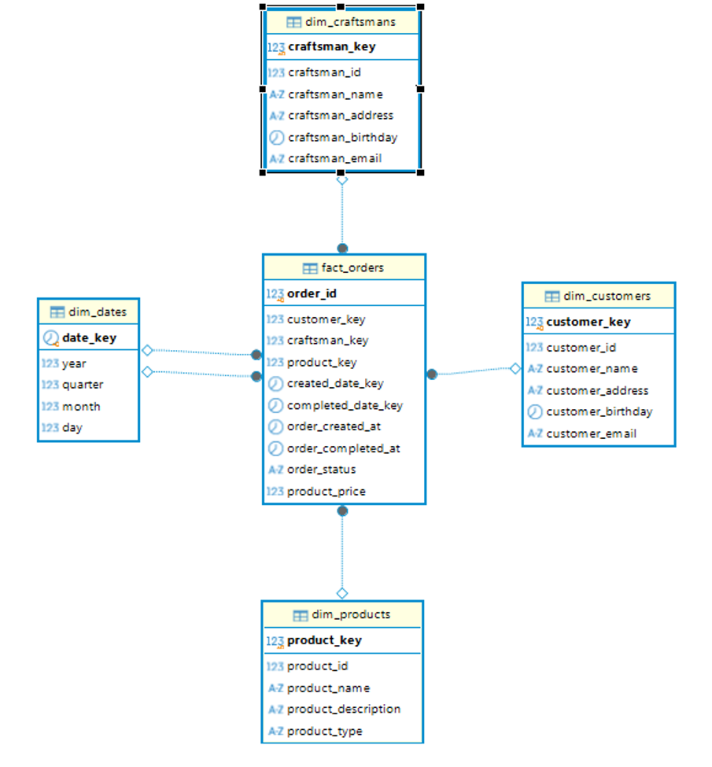

# Лабораторная работа №1: Построение DWH

Безносова Александра, Денисова Мария, группа P3245.

## Цель и задачи работы

Цель работы — построение хранилища данных с полным циклом обработки: от получения записей из разнородных источников до формирования аналитической витрины покупателей. Для достижения цели реализованы загрузка в STG, детальный слой DDS по схеме «звезда» и слой CDM с месячными показателями.

В ходе работы решены следующие задачи:

- Подготовлены три группы источников: таблицы PostgreSQL, CSV через внешние таблицы PostgreSQL и коллекции MongoDB.
- Реализована порционная загрузка в STG с сохранением позиции и общим журналом изменений.
- Созданы измерения покупателей, мастеров, товаров и дат, а также таблица фактов заказов.
- Сформирована месячная витрина покупателей с денежными показателями, статусами заказов и наиболее популярными категориями и мастерами.
- Этапы загрузки и проверки объединены в конвейер Apache Airflow.
- Проверены структура хранилища, восстановление после ошибок и повторное выполнение загрузок.

## Архитектура решения

Для воспроизводимого запуска использован Docker Compose. В стенд входят PostgreSQL 16 для источника и хранилища, MongoDB 7 и Apache Airflow 2.11.0 с Python 3.12. Служебная база Airflow размещена в отдельном контейнере PostgreSQL. Для выполнения задач выбран `LocalExecutor`; общая параллельность ограничена четырьмя задачами.

```text
PostgreSQL: source ───────────────┐
CSV → file_fdw: external_source ──┼→ STG → проверка STG
MongoDB: restaurant_source ───────┘             │
                                                ▼
                              DDS: измерения → факты → проверка DDS
                                                              │
                                                              ▼
                                                 CDM: витрина → проверка CDM
```

В STG сохраняются все три группы источников. Для текущей аналитической модели DDS и витрины CDM используется нормализованный вариант магазина: `craft_market_customers`, `craft_market_craftsmans` и `craft_market_orders`. Остальные таблицы магазина, CSV и MongoDB остаются в STG и в расчёте этой витрины не участвуют.

## Запуск

Для запуска из PowerShell при работающем Docker Desktop с Linux-контейнерами используются следующие команды:

```powershell
docker compose up -d --build
docker compose ps
```

Для полной пересборки без кэша с проверкой базового образа в Docker Hub:

```powershell
.\rebuild.ps1
```

Скрипт выполняет `docker compose build --pull --no-cache setup` и `docker compose up -d --force-recreate`. Для скачивания образов и зависимостей нужен доступ к Docker Hub и PyPI. 

DAG, SQL, скрипты и тесты включены в образ Airflow через COPY. Для разработки эти каталоги также подключены с хоста. 
Сервис `setup` создаёт структуру STG, DDS и CDM непосредственно из DDL и наполняет источники при первом запуске. Таблицы DDS и CDM заполняются последующими задачами Airflow.
Повторный запуск сохраняет данные и позиции загрузки. Тома PostgreSQL и MongoDB сохраняются при пересборке.

`airflow db migrate` в Compose относится к внутренней служебной базе самого Airflow. Инициализация источников и слоёв хранилища выполняется через `CREATE ... IF NOT EXISTS` в `scripts/setup.py` и `sql/*.sql`.

Отметка `public.lab_initialized` предотвращает повторное наполнение источника. Поэтому пересборка образа обновляет код, но не добавляет новые строки из `demo_craft.sql` в уже инициализированную базу. Расширенный набор воспроизводится при первоначальной инициализации пустых баз; результаты такой проверки приведены отдельно от состояния рабочих томов.

## Подключения

| Сервис | Адрес | База | Пользователь / пароль |
|---|---|---|---|
| PostgreSQL источников | `localhost:55433` | `source` | `source` / `source` |
| PostgreSQL хранилища | `localhost:55432` | `dwh` | `dwh` / `dwh` |
| Airflow | [localhost:18080](http://localhost:18080) | — | `admin` / `admin` |
| MongoDB внутри Docker | `source-mongo:27017` | `restaurant_source` | без авторизации в локальном стенде |

В DBeaver используются два подключения PostgreSQL: схемы `source` и `external_source` находятся в базе `source`, а `stg`, `dds`, `cdm` и служебная схема `etl` — в базе `dwh`.

## Источники

| Источник | Объекты |
|---|---|
| PostgreSQL, `source` | 6 таблиц: `craft_market_wide`, `craft_market_masters_products`, `craft_market_orders_customers`, `craft_market_craftsmans`, `craft_market_customers`, `craft_market_orders` |
| PostgreSQL, `external_source` | 3 FOREIGN TABLE: `user_order_log`, `user_activity_log`, `customer_research` |
| MongoDB, `restaurant_source` | 3 коллекции: `clients`, `restaurant`, `orders` |

Внешние таблицы читают `fixtures/*.csv` через `file_fdw` и сервер `csv_files`. Каталог подключён к `source-pg` в `/data/external` только для чтения. CSV разбирает PostgreSQL, Airflow выполняет SELECT. Внешние таблицы описывают все поля файлов в исходном порядке. Формат: UTF-8, разделитель `,`, первая строка — заголовок. Поля сопоставляются по позиции.

Для магазина и CSV используются синтетические учебные данные из `sql/demo_craft.sql` и `fixtures`.

MongoDB наполняется из `../data/json/*.json`. 

Служебная таблица `public.lab_initialized` в PostgreSQL источника хранит отметку первоначального наполнения. Журналирование выполняется в STG.

## Структура STG

В схеме `stg` **12 таблиц данных и 2 служебные таблицы** — `logs` и `settings`.

Шесть таблиц `source` переносятся в одноимённые таблицы STG с теми же столбцами, типами и значениями. Дополнительные технические поля в строки данных не добавляются. DDL находится в `sql/stg_source.sql`.

Типы таблиц магазина соответствуют заданной схеме: первичные ключи — `BIGINT`, остальные идентификаторы — `INTEGER`, даты — `TIMESTAMP` без часового пояса, цена — `NUMERIC(10,2)`. Имена, адреса и email имеют тип `VARCHAR(255)`, тип товара и статус заказа — `VARCHAR(100)`, описание товара — `TEXT`. Все неключевые поля допускают `NULL`.

В `craft_market_masters_products` первичный ключ — только `craftsman_id`: одному мастеру соответствует одна строка. `craft_market_orders_customers` ссылается на неё только по `craftsman_id`; `product_id` не входит в эту связь. В широкой таблице `order_id` не имеет ограничения уникальности. Дополнительного ограничения на неотрицательную цену нет.

Внешние таблицы переносятся с проекциями из задания 2:

| Таблица | Поля STG |
|---|---|
| `user_order_log` | `date_time`, `customer_id`, `quantity`, `payment_amount` |
| `user_activity_log` | `date_time`, `customer_id` |
| `customer_research` | `date_id`, `geo_id`, `sales_qty`, `sales_amt` |

Разные исходные записи могут иметь одинаковую проекцию: такие дубликаты сохраняются. Ключи источника используются для продолжения загрузки и не добавляются в эти таблицы STG.

MongoDB представлена отдельными столбцами верхнего уровня:

| Таблица | Поля |
|---|---|
| `clients` | `_id`, `name`, `phone`, `birthday`, `email`, `login`, `address`, `update_time` |
| `restaurant` | `_id`, `name`, `phone`, `email`, `founding_day`, `menu`, `update_time`, `address` |
| `orders` | `_id`, `restaurant`, `order_date`, `client`, `ordered_dish`, `payed_by_bonuses`, `cost`, `payment`, `bonus_for_visit`, `statuses`, `final_status`, `update_time` |

Вложенные объекты, массивы и адреса сохраняются в `jsonb`, денежные значения — `numeric`, BSON-даты — `timestamptz`. `_id`, `birthday` и `founding_day` хранятся как текст. Отсутствующий необязательный атрибут становится SQL NULL. Неизвестный верхнеуровневый атрибут в загружаемой порции вызывает ошибку вместо потери поля.

В исходном JSON есть некорректный ObjectId ресторана, поэтому при начальном импорте все `$oid` сохраняются строками с исходным текстом. Исходные ссылки, суммы и история статусов переносятся без исправления.

## Загрузка порциями и stg_settings

Использован подход загрузки данных порциями: прочитать позицию, выбрать ограниченную порцию после неё, записать строки, сохранить новую позицию в той же транзакции. Модуль `dags/stg_settings.py` содержит функции `get_setting` и `save_setting`; загрузчики остаются функциями в `dags/dwh_lib.py`.

`stg.settings` содержит `id`, уникальный `settings_key` и `settings JSONB`. На каждую таблицу или коллекцию приходится отдельная запись — всего 12:

| Источник | Сортировка и граница | settings_key |
|---|---|---|
| Таблицы `source` | Первичный ключ; для `craft_market_masters_products` — `craftsman_id` | `source.<таблица>` |
| `user_order_log` | `id` | `external_source.user_order_log` |
| `user_activity_log` | `Id` | `external_source.user_activity_log` |
| `customer_research` | `(date_id, category_id, geo_id)` | `external_source.customer_research` |
| Коллекции MongoDB | `(update_time, _id)` | `mongo.<коллекция>` |

Примеры сохранённой позиции:

```json
{"last_loaded_key": [3]}
{"last_loaded_key": ["2024-04-01", 2, 78]}
{"last_update_time": "2024-05-24T12:00:00+00:00", "last_loaded_id": "restaurant-1"}
```

SQL-запрос использует `WHERE ключ > сохранённая_позиция ORDER BY ключ LIMIT размер_порции`; составные ключи сравниваются целиком. MongoDB использует аналогичную границу по времени и `_id`. Дополнительный `_id` позволяет обработать разные документы с одинаковым `update_time` на границе порций. Для MongoDB создаются индексы `(update_time, _id)`.

Размер порции задаётся `STG_BATCH_LIMIT` в `compose.yaml`, по умолчанию **2 строки** для наглядности. Значение должно быть положительным. За один запуск задача последовательно обрабатывает все доступные порции. Родительские таблицы магазина загружаются полностью до дочерних, чтобы сохранялись внешние ключи.

Для PostgreSQL задача читает один снимок обычных таблиц в `REPEATABLE READ`. Для каждой MongoDB-коллекции фиксируется верхняя граница в начале её обработки. Новые данные за этой границей попадут в следующий запуск. Строки источника не загружаются целиком в память: приложение получает не больше размера порции за запрос. `file_fdw` при этом может перечитывать весь файл на стороне PostgreSQL для фильтрации и сортировки.

### Правила источников

Для `source` и `external_source` реализована загрузка **только новых записей**:
Новая запись должна иметь ключ строго больше сохранённой позиции; вставки с меньшим ключом, изменения и удаления уже пройденных записей не доставляются автоматически. 
Файлы должны оставаться неизменными на время обработки.

MongoDB доставляет новые и изменённые документы. При каждом изменении необходимо обновлять `update_time` так, чтобы новая пара `(update_time, _id)` была больше сохранённой позиции. Время должно быть BSON date, `_id` — строкой. Изменения с прежним или более ранним временем и поздние вставки позади позиции не обнаруживаются. Физические удаления документов не переносятся.

### Транзакции и ошибки

Каждая порция фиксируется отдельно: строки STG, их записи в `logs`, новая позиция в `settings` и счётчик загрузки в `etl.loads` входят в одну транзакцию. При ошибке вся текущая порция откатывается; предыдущие успешные порции остаются. Повторная попытка продолжает с последней сохранённой позиции. Полностью завершённый повторный запуск обрабатывает 0 строк и не добавляет событий в журнал.

Сессионные advisory locks исключают параллельную работу двух загрузчиков одного источника даже между транзакциями порций. PostgreSQL и MongoDB загружаются независимыми задачами. Общей транзакции для всех источников нет.

`stg.settings` нужно сохранять вместе с данными STG. Простое удаление позиции не является безопасным способом перезагрузки: проекции CSV не содержат ключей и могли бы задублироваться. При непустой таблице CSV и отсутствующей позиции загрузчик явно выдаёт ошибку.

## Общий журнал

`stg.logs` содержит четыре поля по образцу задания 3:

| Поле | Значение |
|---|---|
| `id` | Автоматический идентификатор события |
| `date_time` | Время изменения STG |
| `table_name` | Имя таблицы данных |
| `record_data` | JSON самой строки |

Триггеры стоят на всех 12 таблицах данных. INSERT/UPDATE сохраняют новое состояние, DELETE — предыдущее; перед TRUNCATE сохраняется каждая удаляемая строка. UPDATE без изменения значений не создаёт событие. `settings` и сам `logs` не журналируются. Поля типа операции в заданном формате нет: по одной записи нельзя однозначно различить вставку, обновление и удаление.

Автоматическая доставка удалений из источников в текущем режиме не предусмотрена; триггеры DELETE/TRUNCATE фиксируют такие операции, если они непосредственно выполняются в STG.

## Детальный слой DDS

Для аналитической обработки построена схема «звезда». Детализация таблицы фактов — один заказ из `stg.craft_market_orders`, идентифицируемый по `order_id`. Состав объектов определён в `sql/dds.sql`.



| Таблица | Назначение и ключ |
|---|---|
| `dds.dim_customers` | Покупатели: суррогатный `customer_key`, уникальный исходный `customer_id`, имя, адрес, дата рождения и email |
| `dds.dim_craftsmans` | Мастера: суррогатный `craftsman_key`, уникальный исходный `craftsman_id` и описательные атрибуты |
| `dds.dim_products` | Товары: суррогатный `product_key`, уникальный исходный `product_id`, название, описание и категория |
| `dds.dim_dates` | Календарь: `date_key` типа `DATE`, год, квартал, месяц и день |
| `dds.fact_orders` | Заказы: `order_id`, ссылки на измерения, время создания и завершения, статус и цена |

Измерение дат связано с фактом дважды: через `created_date_key` и `completed_date_key`. Полные временные метки также сохранены в фактах, поскольку для расчёта длительности заказа нужны время и дата, а не только календарный день.

### Загрузка измерений и фактов

Сначала выполняется `load_dds_dimensions.sql`. Покупатели и мастера поступают из соответствующих справочников STG. Товары выбираются из заказов: `DISTINCT ON (product_id)` оставляет запись с наиболее поздней датой создания заказа, а при совпадении дат — с наибольшим `order_id`. В календарь попадают все непустые даты создания и завершения заказов.

Для покупателей, мастеров и товаров используется `ON CONFLICT ... DO UPDATE`. Повторная загрузка обновляет описательные атрибуты, сохраняя суррогатный ключ. Отдельные исторические версии атрибутов не сохраняются, повторяющиеся даты пропускаются через `DO NOTHING`.

После измерений выполняется `load_dds_facts.sql`. Исходные идентификаторы заменяются ссылками на измерения. Покупатель, мастер, товар и дата создания присоединяются через `JOIN`, дата завершения — через `LEFT JOIN`, поэтому незавершённый заказ может иметь пустую дату завершения. При конфликте по `order_id` обновляются все загружаемые поля факта.

Каждый SQL-файл выполняется в собственной транзакции. DDS перечитывает соответствующие таблицы STG целиком; отдельной позиции инкремента для этого слоя нет. Обновления предотвращают дубли по ключам, но не удаляют строки DDS, исчезнувшие из STG.

Задача `validate_dds` проверяет, что таблица фактов не пуста и число заказов совпадает с `stg.craft_market_orders`. Это позволяет заметить потерю строк при обязательных соединениях, но не заменяет проверку значений каждого атрибута.

## Аналитическая витрина CDM

В слое CDM создана таблица `cdm.customer_report`. Одна строка соответствует одному покупателю за один месяц создания заказов. Уникальность обеспечена парой `(customer_id, report_period)`; `report_period` содержит первый день месяца. Дополнительно сохраняются год, месяц и описательные атрибуты покупателя.

| Поле | Правило расчёта                                                                             |
|---|---------------------------------------------------------------------------------------------|
| `customer_money` | Сумма, которую потратил заказчик                                                            |
| `platform_money` | Сумма, которую заработала платформа от покупок заказчика (10% от суммы завершённых заказов) |
| `count_order` | Количество всех заказов покупателя за месяц                                                 |
| `avg_price_order` | Средняя стоимость одного заказа покупателя за месяц, округлённая до двух знаков             |
| `median_time_order` | Медианная длительность завершённых заказов в днях, с учётом времени суток                   |
| `top_product_category` | Самая популярная категория товаров у этого заказчика за месяц                               |
| `top_craftsman_id` | Идентификатор мастера с наибольшим числом заказов                                           |
| `count_order_created` | Количество созданных за месяц заказов                                                       |
| `count_order_in_progress` | Количество заказов в процессе изготовки                                                     |
| `count_order_delivery` | Количество заказов в доставке                                                               |
| `count_order_done` | Количество завершенных заказов                                                              |
| `count_order_not_done` | Количество незавершенных заказов                                                            |

Месяц определяется по `order_created_at`. Например, заказ, созданный в апреле и завершённый в мае, относится к апрельскому отчёту. Медиана рассчитывается через `PERCENTILE_CONT(0.5)` по разности `order_completed_at - order_created_at`, переведённой из секунд в дни. В расчёт входят только заказы `done` с заполненным временем завершения.

В `load_cdm_customer_report.sql` расчёт разделён на CTE: месячные показатели, число заказов по категориям и число заказов по мастерам. Для выбора лидеров применяется `ROW_NUMBER()`. При равенстве количества заказов категория выбирается по возрастанию `product_type` в порядке сортировки базы, мастер — по наименьшему `craftsman_id`. Это обеспечивает воспроизводимость выбора.

В текущей формуле `SUM(COALESCE(product_price, 0)) FILTER (WHERE order_status = 'done')` пустая цена завершённого заказа заменяется нулём. Если за месяц нет ни одного завершённого заказа, сумма и комиссия остаются `NULL`: внутри фильтра нет строк для суммирования. При отсутствии подходящих завершённых заказов медиана также равна `NULL`. Средняя цена при этом рассчитывается по всем статусам, поэтому её нельзя получить делением `customer_money` на `count_order`.

При каждом запуске показатели пересчитываются по всей таблице фактов, строки обновляются через `ON CONFLICT (customer_id, report_period) DO UPDATE`. Отдельной позиции загрузки CDM нет; строки периодов, исчезнувшие из входного набора, автоматически не удаляются. Задача `validate_cdm` проверяет только наличие хотя бы одной строки витрины.

## Оркестрация Airflow и проверка результата

Для управления конвейером настроена связь трёх DAG. `lab_dwh` запускается каждые 10 минут по UTC, без backfill, с `max_active_runs=1`. Его задачи имеют два повтора через 20 секунд; задачи загрузки и проверки STG ограничены пятью минутами выполнения.

```text
lab_dwh:
  postgres_to_stg ─┐
  mongo_to_stg ────┴─ validate_stg → trigger_dds
                                       │
lab_dds:                               ▼
  load_dimensions → load_facts → validate_dds → trigger_cdm
                                                  │
lab_cdm:                                          ▼
  load_customer_report → validate_cdm
```

`lab_dds` и `lab_cdm` не имеют собственного расписания (`schedule=None`). Их запуск выполняется через `TriggerDagRunOperator` после успешной проверки предыдущего слоя. В обоих операторах включён `wait_for_completion=True`, интервал проверки — 10 секунд, поэтому родительская задача ожидает результат дочернего DAG.

Для `lab_dds` также задан `max_active_runs=1`. У задач `lab_cdm` настроены два повтора через 20 секунд; ограничение `max_active_runs` в этом DAG явно не задано.

`etl.loads` хранит число обработанных строк за запуск для `pg_stg` и `mongo_stg`, включая все успешно зафиксированные порции и повторные попытки с тем же run_id. Это число обработанных строк, а не полный размер STG. Для `validate_stg` значение 12 означает число проверенных таблиц данных. Этапы DDS и CDM не записываются в `etl.loads`; их состояние отслеживается в Airflow.

База `dwh`:

```sql
SELECT settings_key, settings FROM stg.settings ORDER BY settings_key;
SELECT * FROM stg.logs ORDER BY id DESC LIMIT 30;
SELECT * FROM etl.loads ORDER BY completed_at DESC LIMIT 12;
SELECT * FROM stg.user_order_log;
SELECT * FROM stg.orders;
SELECT * FROM dds.fact_orders ORDER BY order_id;
SELECT * FROM cdm.customer_report ORDER BY customer_id, report_period;
```

Ручной запуск:

```powershell
docker compose exec -T airflow-scheduler airflow dags trigger lab_dwh
docker compose exec -T airflow-scheduler airflow dags list-runs -d lab_dwh
docker compose exec -T airflow-scheduler airflow dags list-runs -d lab_dds
docker compose exec -T airflow-scheduler airflow dags list-runs -d lab_cdm
docker compose exec -T airflow-scheduler airflow dags list-import-errors --output json
```

Для полного ручного прогона достаточно запустить `lab_dwh`: при успешном выполнении он последовательно инициирует DDS и CDM. По отдельности `lab_dds` можно запускать после заполнения STG, а `lab_cdm` — после заполнения DDS.

## Проверка реализации

### Интеграционные тесты STG

Для проверки загрузчиков используется набор интеграционных тестов:

```powershell
docker compose run --rm --no-deps -T --entrypoint python setup /opt/airflow/tests/integration.py
```

Тесты создают отдельные базы с уникальными именами на PostgreSQL и MongoDB, проверяют инициализацию с нуля и удаляют их по завершении. Рабочие данные и позиции не меняются; планировщик останавливать не требуется. Для сценариев CSV используется `file_fdw` с выводом контролируемой команды `printf`, поэтому временные файлы не создаются.

Проверяются структура и значения, порции, повторный setup, новые ID, составные ключи и связи, одинаковое время MongoDB, обновления, дубликаты проекций CSV, откат данных/логов/позиции при сбое и продолжение, неверные ключи, отсутствующий файл, блокировка параллельных загрузок и защита от потери позиции. Этот набор не выполняет задачи DDS и CDM.

При проверке 23 октября 2026 года успешно пройдены **все 15 тестов**, время выполнения — 10,635 с. 


## Файлы проекта

- `compose.yaml`, `Dockerfile`, `rebuild.ps1` — окружение и пересборка.
- `scripts/setup.py` — создание источников и таблиц STG/DDS/CDM, начальное наполнение, индексы MongoDB и пользователь Airflow.
- `scripts/check_consistency.py` — сверка рабочих схем и индексов с чистой инициализацией.
- `sql/craft_source.sql`, `sql/demo_craft.sql`, `sql/external_source.sql` — источники.
- `sql/stg_source.sql`, `sql/stg.sql` — таблицы STG, настройки и журнал.
- `sql/dds.sql`, `sql/cdm.sql` — структура измерений, фактов и витрины.
- `sql/load_dds_dimensions.sql`, `sql/load_dds_facts.sql` — загрузка DDS.
- `sql/load_cdm_customer_report.sql` — расчёт месячных показателей покупателей.
- `dags/stg_settings.py` — чтение и сохранение позиции по образцу из `examples`.
- `dags/dwh_lib.py` — функции порционной загрузки и проверки.
- `dags/lab_dwh.py` — загрузка и проверка STG по расписанию, запуск DDS.
- `dags/lab_dds.py` — измерения, факты, проверка DDS и запуск CDM.
- `dags/lab_cdm.py` — загрузка и проверка витрины.
- `tests/integration.py` — интеграционные проверки в изолированных базах.
- `fixtures/*.csv`, `../data/json/*.json` — исходные файловые данные.

## Выводы

В результате работы построен конвейер доставки данных в трёхслойное хранилище. 
В STG реализована загрузка порциями с сохранением позиции и журналированием, 
в DDS выделены измерения и факты, в CDM сформирована месячная витрина покупателей. 
Последовательность этапов и проверок определена тремя связанными DAG Airflow.

